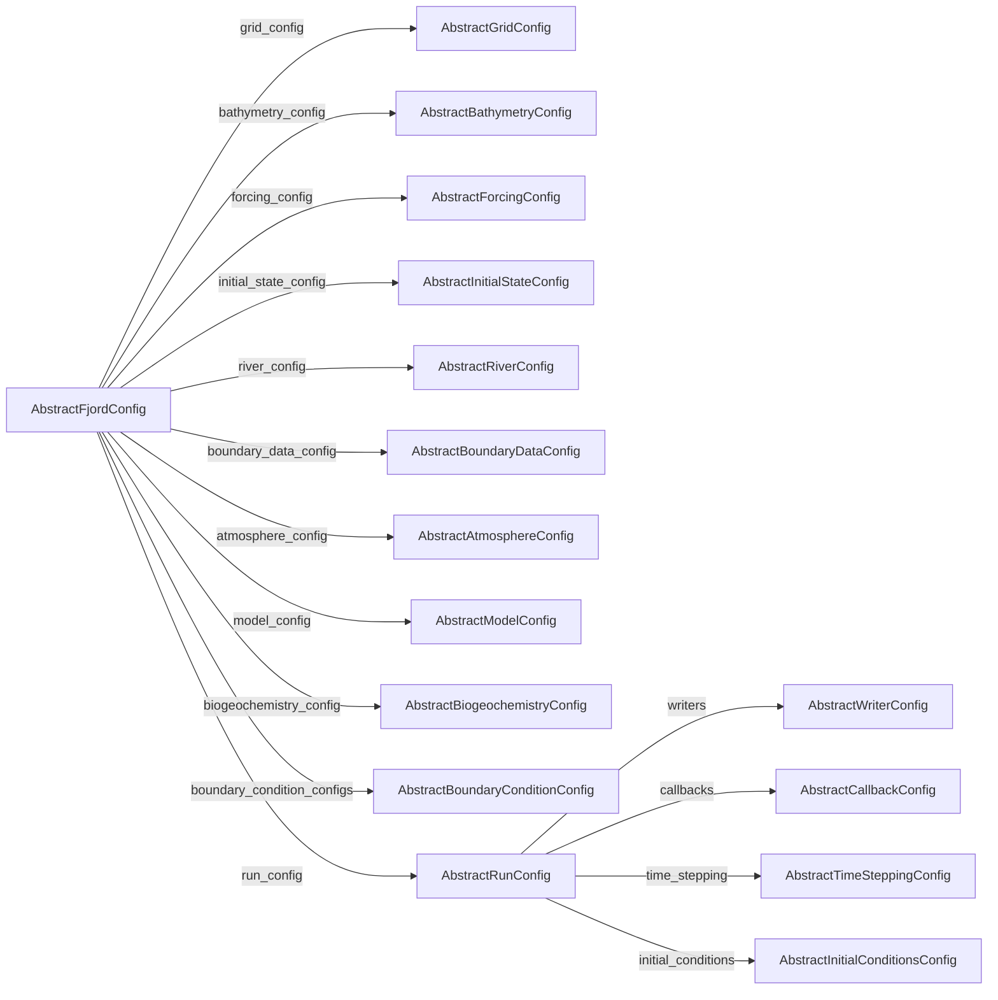

# Dispatch map

Generated by `julia --project docs/make_dispatch_map.jl` from the loaded package; do not edit by
hand. The "Dispatch map" test fails when this file no longer matches the code.

A hook is a function a supertype's docstring lists under "# Methods a subtype provides". A cell
says whether a built-in type has a method of its own (✓), inherits the supertype's (default), or
has none (—, or **missing** for a required hook).

## Components

Which supertype each accessor returns, by the accessor's name.

Not reached through an accessor: `AbstractClosureConfig`, `AbstractFreeSurfaceConfig`, `AbstractObservationConfig`.

## Steps

Each step has one method, on `AbstractFjordConfig`. It reads components through the accessors
and hands them to the work function, which dispatches on them.

| Step | Reads | Work function |
|---|---|---|
| `prepare_bathymetry` | `grid_config`, `bathymetry_config`, `boundary_data_config` | `process_bathymetry` |
| `download_forcing` | `grid_config`, `forcing_config` | `fetch_forcing` |
| `prepare_forcing` | `grid_config`, `bathymetry_config`, `forcing_config`, `boundary_data_config`, `run_config` | `regrid_forcing` |
| `download_initial_state` | `grid_config`, `initial_state_config`, `run_config` | `fetch_initial_state` |
| `prepare_initial_state` | `grid_config`, `bathymetry_config`, `initial_state_config`, `boundary_data_config`, `run_config` | `regrid_initial_state` |
| `add_rivers` | `grid_config`, `bathymetry_config`, `river_config`, `forcing_config`, `run_config` | `place_rivers` |
| `download_boundary_data` | `grid_config`, `boundary_data_config` | `fetch_boundary_data` |
| `prepare_boundary_data` | `grid_config`, `bathymetry_config`, `boundary_data_config`, `run_config` | `regrid_boundary_data` |
| `download_atmosphere` | `grid_config`, `atmosphere_config` | `fetch_atmosphere` |
| `prepare_atmosphere` | `grid_config`, `atmosphere_config`, `run_config` | `regrid_atmosphere` |
| `run_simulation` | `run_config` | `run_loops` |
| `validate_simulation` | `run_config`, `bathymetry_config` | `score_run` |
| `build_simulation` | `run_config` and the whole setup | `assemble_simulation` |

## Hooks

### `AbstractAtmosphereConfig`

| Hook | Status | `NORA3Config` |
|---|---|---|
| `atmosphere_time_steps` | required | ✓ |
| `atmosphere_source_grid` | required | ✓ |
| `atmosphere_variable_names` | required | ✓ |
| `fetch_atmosphere` | only if it downloads | ✓ |
| `prescribed_atmosphere` | only if the setup is simulated | ✓ |
| `prescribed_radiation` | only if the setup is simulated | ✓ |
| `atmosphere_date_range` | optional | ✓ |

### `AbstractBathymetryConfig`

| Hook | Status | `DybdedataConfig` |
|---|---|---|
| `bathymetry_dataset` | required | ✓ |
| `regrid_options` | optional | ✓ |
| `smoothing_options` | optional | ✓ |

### `AbstractBiogeochemistryConfig`

| Hook | Status |
|---|---|
| `model_biogeochemistry` | required |

No built-in implementation.

### `AbstractBoundaryConditionConfig`

| Hook | Status | `AirSeaFluxes` | `OpenLateralBoundaryFromData` | `QuadraticBottomDrag` |
|---|---|---|---|---|
| `boundary_condition_sides` | required | ✓ | ✓ | ✓ |

### `AbstractBoundaryDataConfig`

| Hook | Status | `NorKystBoundaryDataConfig` | `NorKystHindcastBoundaryDataConfig` |
|---|---|---|---|
| `boundary_time_steps` | required | ✓ | ✓ |
| `boundary_source_grid` | required | ✓ | ✓ |
| `boundary_variable_names` | required | ✓ | ✓ |
| `fetch_boundary_data` | only if it downloads | ✓ | ✓ |
| `boundary_date_range` | optional | default | default |
| `boundary_source_slab` | optional | ✓ | default |

### `AbstractCallbackConfig`

| Hook | Status | `ProgressCallback` |
|---|---|---|
| `attach_callback!` | required | ✓ |

### `AbstractClosureConfig`

| Hook | Status | `BoundarySponge` | `RiverMouthMixing` |
|---|---|---|---|
| `model_closure` | required | ✓ | ✓ |

### `AbstractFjordConfig`

| Hook | Status | `FjordConfig` |
|---|---|---|
| `grid_config` | required | ✓ |
| `bathymetry_config` | required | ✓ |
| `forcing_config` | required | ✓ |
| `initial_state_config` | required | ✓ |
| `river_config` | required | ✓ |
| `boundary_data_config` | required | ✓ |
| `atmosphere_config` | required | ✓ |
| `model_config` | required | ✓ |
| `biogeochemistry_config` | required | ✓ |
| `boundary_condition_configs` | required | ✓ |
| `run_config` | required | ✓ |
| `FjordSim.Simulations.model_inputs` | optional | default |
| `FjordSim.CLI.pipeline_steps` | optional | default |

### `AbstractForcingConfig`

| Hook | Status | `NorKystConfig` | `NorKystHindcastConfig` |
|---|---|---|---|
| `forcing_time_steps` | required | ✓ | ✓ |
| `forcing_source_grid` | required | ✓ | ✓ |
| `forcing_variable_names` | required | ✓ | ✓ |
| `fetch_forcing` | only if it downloads | ✓ | ✓ |
| `simulation_forcing` | optional | default | default |
| `forcing_date_range` | optional | default | default |

### `AbstractFreeSurfaceConfig`

| Hook | Status | `SplitExplicitFreeSurfaceConfig` |
|---|---|---|
| `free_surface` | required | ✓ |

### `AbstractGridConfig`

| Hook | Status | `EvenGrid` |
|---|---|---|
| `domain_grid` | required | ✓ |
| `simulation_grid` | required | ✓ |

### `AbstractInitialConditionsConfig`

| Hook | Status | `FromForcing` | `FromInitialState` | `FromResults` |
|---|---|---|---|---|
| `FjordSim.Simulations.resolve_initial_conditions` | required | ✓ | ✓ | ✓ |

### `AbstractInitialStateConfig`

| Hook | Status | `NorKystInitialStateConfig` |
|---|---|---|
| `initial_state_record` | required | ✓ |
| `initial_state_source_grid` | required | ✓ |
| `initial_state_variable_names` | required | ✓ |
| `fetch_initial_state` | only if it downloads | ✓ |

### `AbstractModelConfig`

| Hook | Status | `CoupledHydrostaticModel` |
|---|---|---|
| `coupled_model` | required | ✓ |
| `model_tracers` | required | ✓ |
| `model_boundary_conditions` | optional | default |

### `AbstractObservationConfig`

| Hook | Status | `CsvObservations` | `KartverketSeaLevel` |
|---|---|---|---|
| `observation_stations` | required | ✓ | ✓ |
| `observation_series` | required | ✓ | ✓ |
| `download_observations` | optional | default | ✓ |
| `observations_directory` | optional | default | default |

### `AbstractRiverConfig`

| Hook | Status | `NVERiversConfig` |
|---|---|---|
| `river_locations` | required | ✓ |
| `river_discharge` | required | ✓ |
| `river_series` | required | ✓ |
| `fetch_rivers` | only if it downloads | ✓ |
| `river_search_radius` | optional | default |
| `river_maximum_inflow_velocity` | optional | default |

### `AbstractRunConfig`

| Hook | Status | `RunConfig` |
|---|---|---|
| `results_root` | required | ✓ |
| `FjordSim.Simulations.run_architecture` | required | ✓ |
| `writers` | required | ✓ |
| `callbacks` | required | ✓ |
| `time_stepping` | required | ✓ |
| `initial_conditions` | required | ✓ |
| `start_date` | required | ✓ |
| `stop_time` | required | ✓ |
| `loops` | required | ✓ |
| `pickup` | required | ✓ |

### `AbstractTimeSteppingConfig`

| Hook | Status | `AdaptiveTimeStep` |
|---|---|---|
| `attach_time_stepping!` | required | ✓ |
| `initial_time_step` | required | ✓ |

### `AbstractWriterConfig`

| Hook | Status | `CheckpointWriter` | `FieldSnapshotWriter` | `FieldStationWriter` | `SectionWriter` | `SnapshotWriter` | `StationWriter` | `SurfaceSnapshotWriter` |
|---|---|---|---|---|---|---|---|---|
| `attach_writer!` | required | ✓ | ✓ | ✓ | ✓ | ✓ | ✓ | ✓ |
| `FjordSim.Simulations.checkpoint_trait` | optional | ✓ | default | default | default | default | default | default |
| `FjordSim.Simulations.output_path_trait` | optional | default | ✓ | ✓ | ✓ | ✓ | ✓ | ✓ |
